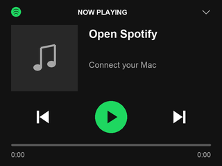

# Garmin nüvi lab

Repurpose vintage Garmin nüvi 200 and 350 navigators as programmable displays while keeping their original motherboards, LCDs, touchscreens, and enclosures.

Both tested units now run a Mac-connected Spotify remote with live artwork, track information, one progress bar, and touch controls with pressed states. Custom ARM code runs from RAM after an SD-card loader handoff; a Mac supplies the graphical interface and Spotify integration over a private USB protocol. No Raspberry Pi or replacement LCD was needed for this milestone.



## Tested hardware

| Model | Hardware ID | Stock software | Current result |
| --- | --- | --- | --- |
| nüvi 200 | 0660 | 5.00 | Live display and native queued touch-button events |
| nüvi 350 NA | 0476 | 6.20 | Live display, calibrated touch, and host-qualified playback controls |

These are specific tested combinations, not a claim of compatibility with all nüvi devices. The 350 needs its own RAM entry, framebuffer packing, and touch driver; do not rename the 200 binary and load it on the 350.

## Read first

- [Findings and approach comparison](docs/findings.md)
- [Runtime architecture and USB protocol](docs/architecture.md)
- [350 port and touch-controller fix](docs/nuvi350.md)
- [Build, test, and local setup](docs/development.md)
- [Technical references](docs/references.md)

The current player layout has left-side artwork, aligned track text, circular playback controls, and a single bottom progress bar. The bridge runs on macOS; it is not yet a standalone music player or Raspberry Pi port.

## Local checks

On macOS with Python 3.9+, Pillow, and the Xcode command-line tools available:

```sh
python3 -m pip install -r requirements.txt
python3 scripts/prepare_workspace.py
python3 scripts/check_player_host.py
python3 scripts/check_nuvi350_encoding.py
python3 scripts/check_nuvi350_input.py
python3 scripts/check_nuvi350_touch_capture.py
python3 scripts/build_rectangle_probe.py --experiment nuvi350-touchxy2
```

The checks use mock interfaces or synthetic fixtures; the build only writes local output. Full native handoff audits additionally require the owner's locally extracted, matching firmware images. See the development guide before using hardware tools.

## Repository contents

- `experiments/`: model-specific ARM programs and earlier lab stages; generated diagnostic graphics are included where assembly requires them.
- `scripts/`: firmware inspection, local builds, native audits, guarded SD staging, IOKit hosts, rendering, calibration, and Spotify bridges.
- `tests/fixtures/`: synthetic data for offline checks; never use the fixture as device calibration.
- `config/targets.example.json`: template for private volume identities.
- `artifacts/display-probe/`: the two original, generated JPEG test patterns.
- `docs/`: curated findings and reproduction notes.

Backups, proprietary firmware and maps, raw device evidence, personal calibration/logs, downloaded reference copies, and live session notes stay in ignored local directories. No credentials are required in the repository.

## Hardware boundary

Review the source and understand recovery before executing an SD payload. These programs take over the original UI and need a reset to leave it. Use normal host ejection before removing media or resetting a mounted Garmin. Remove the test SD before recovery reset. The 350's RESET is behind its raised antenna.

Stagers default to planning, pin target identity and reviewed hashes, and require `--install` to write the SD. They preserve the original lab's expected prior-state checks; this repository is not a turnkey installer for another device. No provided experiment flashes stock firmware. Never connect unknown panel pins to GPIO, guess supply voltages, or bypass battery protection.
